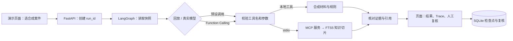

# 从页面到代码：司法鉴定报告质控 Agent

这是可独立运行的本地演示。界面用 HTML、CSS、JavaScript，任务执行由 FastAPI 和 LangGraph 完成。它不包含原业务系统，也不能上传真实委托书、生成真实报告或写回正式审核意见。

## 第一次使用

1. 在 PyCharm 打开 Python 工程，选择该工程的 `.venv/Scripts/python.exe`，右键运行 `run_agent.py`。如果此前已启动同一服务，先停止那一份。访问 [工作台](http://127.0.0.1:8000/)。
2. **先选 LAB-001：** 点“开始审核”。报告上的合成编号与委托书的合成编号不一致，页面会显示两处证据。点“采纳审核结果”或“驳回”，只保存本地演示记录。刷新原任务网址可重新查看。
3. **再选 LAB-005：** 新版案例名带“MCP / RAG”。审核后，展开知识切片，检查文档名称、章节、引用 ID 和来源。真实模型模式下可以生成带引用的复核提示；如果模型生成或校验失败，页面仍能展示原检索结果。
4. **想直接查知识：** 在页面下方“司法知识库”输入“鉴定程序 内部复核”，点“检索”。这是本地 SQLite 检索，通过 MCP 子进程执行，通常不会请求大模型。
5. **想看到请求：** 浏览器按 F12 → Network（网络）→ Fetch/XHR，再点“开始审核”。可以看到发往本机的 `POST /api/audit-runs`，在响应里看 `mode`、`trace`、`model_calls`、`tool_calls`。页面的“查看本地 Trace JSON”也是这些信息。Swagger 在 [FastAPI 接口文档](http://127.0.0.1:8000/docs)。
6. **区分连接与执行：** `GET /api/health` 返回 `live` 只代表已选真实模型模式；模型是否实际执行，要看一次审核的“模型决策”事件、工具请求和结束原因。如果只有 LAB-001～004，说明还在看旧进程；停止并重新运行 `run_agent.py`。

浏览器只与 FastAPI 通信。大模型请求由 **Python 后端**发给配置的模型服务，所以浏览器不会出现模型供应商的请求地址。回放模式不会调用模型，但仍会做本地检查、实际 MCP 检索、引用校验和人工复核。当前 POST 等任务结果完成后才返回，没有逐步推送；按钮显示等待状态。要展示每一步实时进度，后续应使用运行任务 ID 和 SSE，详见下方改进说明。

## 当前运行流程



模型只提出工具请求，工具由应用执行。证据核对由程序完成；LAB-005 可以另外用公开摘要生成复核提示，再核对引用 ID。LangSmith 是可选的云端追踪，未配置时直接看本地 Trace。

## 目录和文件

```text
ForensicAgentLab/
  app/                    Python 后端
    __init__.py           声明 Python 包
    main.py              FastAPI 入口、模型初始化、接口、SQLite 检查点
    model_settings.py    从本地环境变量或本地 YAML 组装模型参数
    graph.py             合成审核图：选工具、调用、证据校验、暂停和恢复
    domain.py            合成案例、工具参数约束、比对规则和证据结构
    legacy_bridge.py     可选业务桥接：授权检查、报告快照、适配既有返回格式
    mcp_client.py        用 stdio 请求本机 MCP 子进程
    mcp_server.py        MCP 服务端，发布只读检索和索引统计工具
    knowledge.py         PDF/MD/TXT 导入、切片、SQLite FTS5/BM25 查询
  knowledge/
    seed.json            官方来源的人工摘要与出处；不是法规原文
  web/
    index.html           案例选择、审核结果、人工复核、Trace、知识检索布局
    app.js               fetch 请求、页面状态、结果和引文渲染
    style.css            布局、颜色和窄屏样式
  tests/
    test_audit.py        合成审核、范围校验、版本冲突、复核恢复和去重
    test_knowledge.py    切片偏移、日期/专业筛选、MCP 与知识审核
    test_legacy_bridge.py 桥接鉴别、接口兼容、避免把报告正文发给模型
  docs/                   面向读者的操作与开发说明
  run_agent.py            PyCharm 入口：启动本机 Uvicorn 并加载可选 .env
  start.ps1               Windows 命令行入口，可新建虚拟环境并安装依赖
  requirements.txt        运行依赖
  requirements-dev.txt    测试依赖
  .env.example            只含示例配置
  .gitignore              排除密钥、数据库、IDE、本机依赖和缓存
  README.md               项目概况与快速启动
  NOTICE.md               上游来源与改动说明
  LICENSE                 保留的 MIT 许可
```

不提交的本地文件：`.env` 是私有配置；`.venv/` 是解释器环境；`data/checkpoints.sqlite` 存演示任务，`data/knowledge.sqlite` 是检索索引，`data/knowledge-import/` 是本地导入资料；`.idea/` 是 PyCharm 配置。

## 推荐阅读顺序

1. `web/app.js` 的开始审核按钮找到 `POST /api/audit-runs`。
2. `app/main.py` 的 `start()` 看如何创建任务和调用图。先看启动函数如何选择回放或真实模型。
3. `app/graph.py` 依次看 `load_report → decide → tools → verify → review`。对 LAB-005 再看 `ground_guidance`。
4. `app/domain.py` 看工具参数为何不能传入另一个案件 ID。沿知识工具进入 `mcp_client.py → mcp_server.py → knowledge.py`。
5. 再读 `legacy_bridge.py`。它是一条独立的报告快照审核图，和合成演示不共用案件来源或人工审批存储。

这是清晰分层的原型，还不是生产脚手架。下一步更有价值的是接入一类真实形态的脱敏委托书样本、把三步流程跑通并记录评测；随着功能增加，再将接口、流程、工具、存储各自拆为包。不要仅靠新增目录数量判断工程成熟度。

